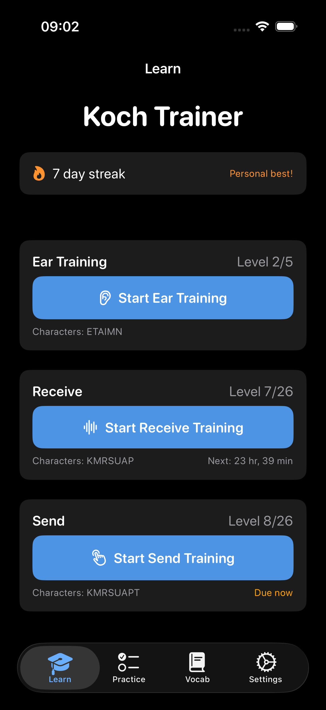
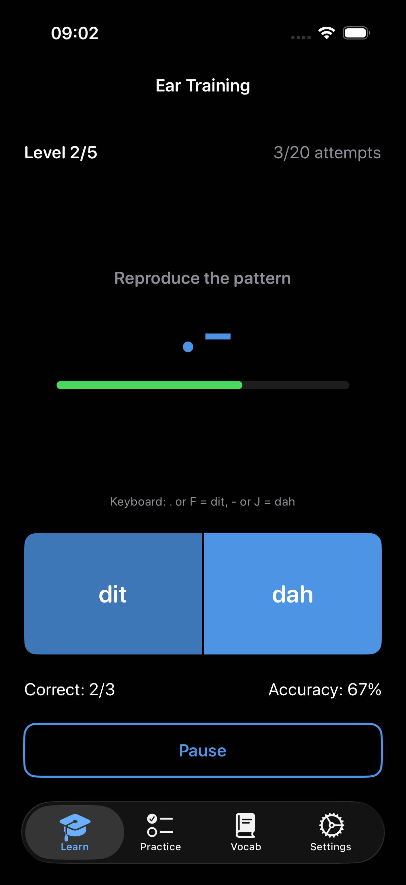
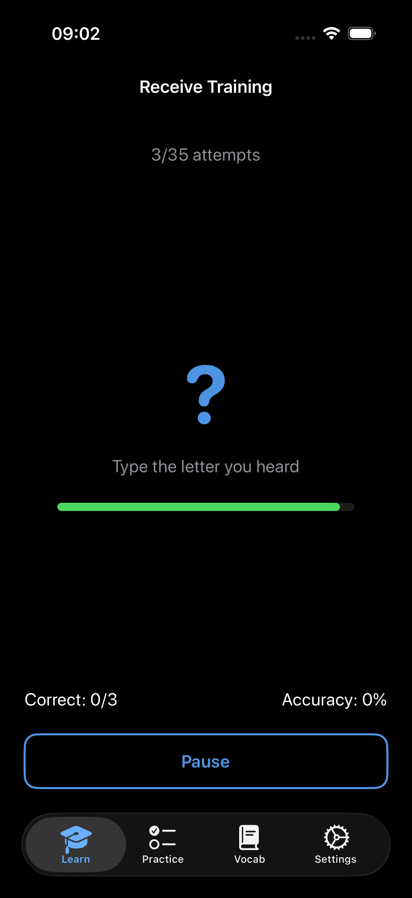
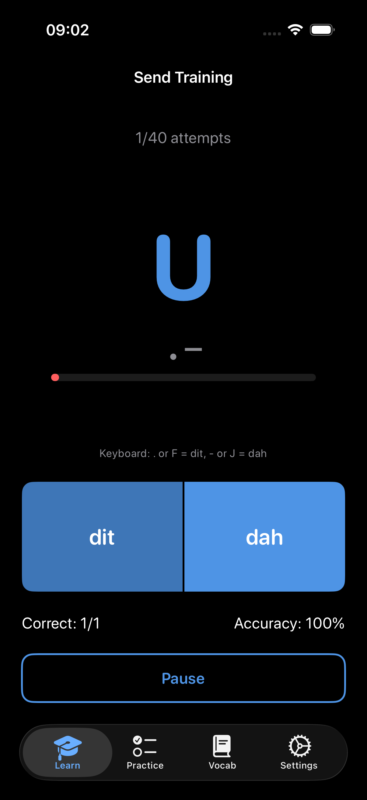
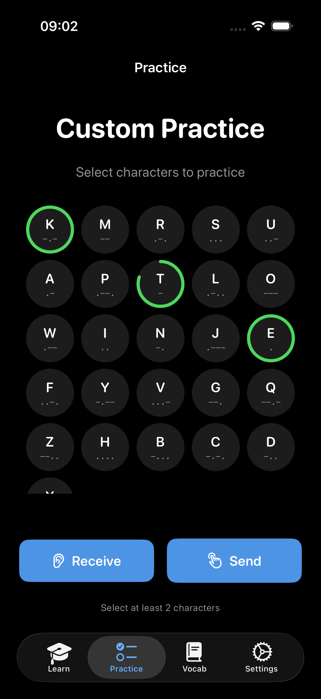
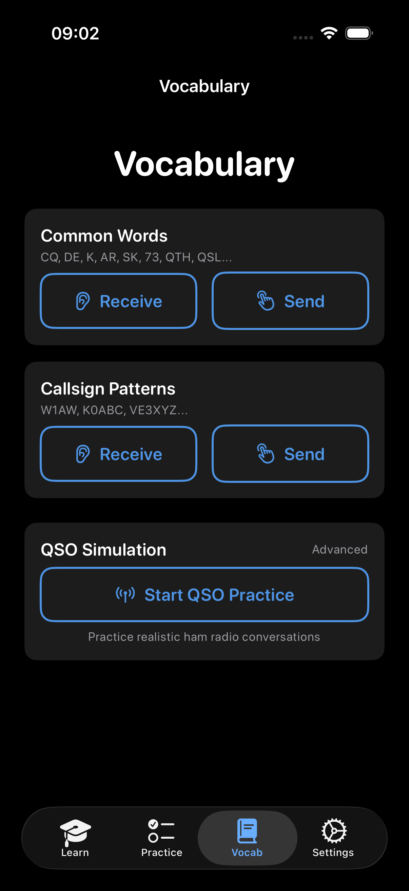
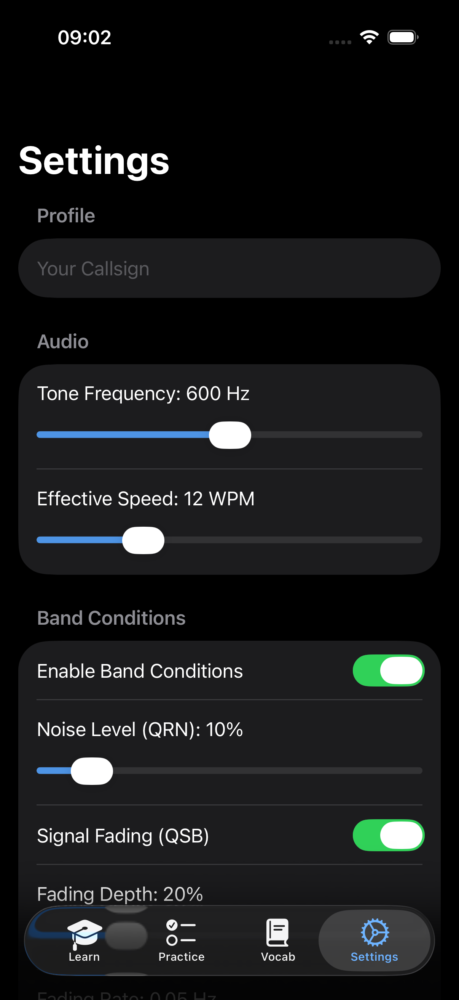

# Koch CW Trainer

> An iPhone app for learning Morse code with the Koch method.

[](LICENSE)
[](https://github.com/punt-labs/koch-trainer-swift/actions/workflows/ci.yml)
[](./prfaq.pdf)

Koch CW Trainer teaches Morse code (called CW, for "continuous wave", in amateur radio) using the Koch method: you hear each character at full speed from the first lesson, starting with two characters and adding one at a time. It is for beginners learning their first 26 letters, including new amateur ("ham") radio operators who want to use Morse code on the air. The app trains receiving (copying what you hear) and sending (keying characters yourself) as separate skills. It runs entirely offline, with no account.

**Platforms:** iPhone, iOS 17 or later

## Quick Start

The app is not distributed through the App Store. To install it, build it from source on a Mac with [Xcode](https://developer.apple.com/xcode/) installed.

Clone the repository:

```bash
git clone https://github.com/punt-labs/koch-trainer-swift.git
```

Open the Xcode project:

```bash
open koch-trainer-swift/KochTrainer.xcodeproj
```

In Xcode, choose an iPhone simulator or a connected iPhone as the run destination, then choose **Product > Run**.

To run on your own iPhone, select your Apple developer team under **Signing & Capabilities** for the KochTrainer target. If Xcode reports that the bundle identifier `com.puntlabs.kochtrainer` is unavailable, change it to one of your own.

## Features

- **Receive Training** — hear a character and type it; 3-second time limit
- **Send Training** — see a character and key it with dit and dah buttons or the keyboard
- **Ear Training** — hear a pattern and tap it back, grouped by pattern length (1 to 5 elements)
- **Koch progression** — a new character unlocks at 90% accuracy over 20 or more attempts
- **Separate receive and send levels** — each skill advances on its own
- **Custom practice** — drill any letters you choose, without changing your level
- **Vocabulary** — practice common amateur radio words, sample callsigns, and your own callsign
- **QSO simulation** — practice scripted on-air conversations with a simulated station
- **Band conditions** — add simulated noise, fading, and interference to the audio
- **Spaced repetition and streaks** — the next practice date depends on your accuracy
- **Reminders** — local notifications, at most 2 per day
- **Accessibility** — VoiceOver reads patterns as "dit dah" and announces feedback; text follows Dynamic Type
- **Six languages** — English (US and UK), German, French, Spanish, and Italian, following your device language

## What It Looks Like

<p align="center">
  
  
  
  
</p>
<p align="center">
  
  
  
</p>

## Using the App

The app has four tabs: **Learn**, **Practice**, **Vocab**, and **Settings**.

### Learn

Learn is where you progress through the 26 letters in Koch order:

```text
K M R S U A P T L O W I N J E F Y V G Q Z H B C D X
```

It has three activities. Each session begins by showing every unlocked character with its pattern and playing its sound.

- **Receive Training** plays a character. Type the letter you heard before the 3-second countdown ends. If you answer wrongly, the app replays the correct character.
- **Send Training** shows a character without its pattern. Key it with the dit (short) and dah (long) buttons, or with a hardware keyboard: `.` or `F` for dit, `-` or `J` for dah. The app plays a tone for each element and checks the pattern when you stop keying.
- **Ear Training** plays a pattern for you to tap back with the dit and dah buttons. It works up from 1-element patterns to 5-element patterns. It does not change your receive or send level.

Receive and send each start with K and M. When you reach 90% accuracy over at least 20 attempts in a session, the next character unlocks.

The Learn tab shows your daily streak once you have one. The Receive and Send rows show when each is next due for practice, or "Due now".

### Practice

Practice lets you choose any letters from a grid (at least 2) and train them in receive or send mode. Each letter in the grid shows a ring for your accuracy with it. Your accuracy is recorded, but practice sessions never advance your level.

### Vocab

Vocab trains whole words in receive or send mode. Words you get wrong more often come up more often. The built-in sets are:

- **Common Words** — amateur radio abbreviations and Q codes such as CQ, DE, RST, QTH, QSL, 73, and TNX
- **Callsign Patterns** — sample callsigns from the US, Canada, Europe, and elsewhere, such as W1AW and VE3ABC
- **Your Callsign** — appears when you enter your callsign in Settings

Vocab also opens **QSO Simulation**. A QSO is a two-way radio contact. You key your side of the conversation in Morse code, and a simulated station answers with scripted replies; no network or language model is involved. Choose how the contact starts:

- **Call CQ** — you call CQ ("calling any station") and the simulated station answers
- **Answer CQ** — the simulated station calls CQ and you answer

Then choose a style:

| Style | Exchange |
|-------|----------|
| First Contact | Callsigns, signal report, 73 (best regards) |
| Signal Report | Callsigns, signal report, names, 73 |
| Contest | Signal report and serial number |
| Rag Chew | Names, locations, weather, and equipment |

While you key, the screen shows your speed in words per minute (WPM). The simulated station's text appears as its audio plays, and you can hide it to copy by ear. Callsigns and signal reports use the digits 0–9.

### Settings

| Setting | What it does |
|---------|--------------|
| Your Callsign | Used in Vocab and QSO simulation |
| Tone Frequency | 400–800 Hz; default 600 Hz |
| Effective Speed | 10–18 WPM; characters always play at 20 WPM (see [Audio Timing](#audio-timing)) |
| Band Conditions | Adds atmospheric noise (QRN), signal fading (QSB), and interference from another station (QRM); presets for good conditions, a contest pileup, and difficult conditions |
| Notifications | Practice reminders, streak reminders, and quiet hours (10 PM to 8 AM) |

Settings also shows your current level, overall accuracy, current and longest streaks, and the number of sessions you have completed. It has a button to reset all progress.

### Practice Schedule

After each session, the app sets the next practice date for that skill:

| Session accuracy | Next interval |
|------------------|---------------|
| 90% or higher | Doubles, up to 30 days |
| 70–89% | Unchanged |
| Below 70% | Resets to 1 day |

During your first 14 days, the interval is capped at 2 days. If you miss practice for more than twice the interval, it resets to 1 day. Your streak counts consecutive calendar days with at least one session.

Notifications are local; nothing is sent from a server. The app sends at most 2 per day, at least 4 hours apart, and none during quiet hours (10 PM to 8 AM) while that setting is on. It is on by default.

## Why This App?

The iOS App Store has several Morse code apps. This table shows how Koch CW Trainer compares:

| App | Price | Focus | Best For |
|-----|-------|-------|----------|
| **Koch CW Trainer** (this app) | Free (build from source) | Koch method fundamentals | Beginners learning their first 26 characters |
| [Morse Trainer Pro](https://morsetrainerpro.com/) | Freemium | Advanced training, hardware integration | Operators with Morserino/WinKeyer who want contest simulation |
| [Ham Morse](https://apps.apple.com/us/app/ham-morse/id315980140) | $4.99 | Comprehensive drills, news feeds | Active hams maintaining proficiency |
| [Morse-It](https://apps.apple.com/us/app/morse-it/id284942940) | $0.99 + IAP | Translation, practice, and many options | Users who want extensive customization |
| [Morse Mania](https://apps.apple.com/us/app/morse-mania-learn-morse-code/id1511042196) | Freemium | Gamified progression | Learners who enjoy game-style apps |

### Scope

Koch CW Trainer is designed for people who have not yet learned Morse code. It covers the 26 letters and stops there. Once you know all 26 and can copy at around 15 WPM, apps such as Morse Trainer Pro and Ham Morse offer features this app does not, such as contest simulation, hardware paddles, and news feeds.

### Differences

- **Ear Training** — modeled on listen-and-repeat drills in language-learning apps: you hear a pattern and tap it back.
- **No cost** — no ads, subscriptions, or in-app purchases. The source is open under the MIT license.
- **Native SwiftUI** — built with Apple's SwiftUI framework, with no web views or third-party libraries.
- **Offline and private** — the app makes no network requests and has no analytics or tracking SDKs.

### Respect for the Ecosystem

[Morse Trainer Pro](https://morsetrainerpro.com/) is a comprehensive platform with features this app does not attempt: Morserino integration, CW Rooms for real-time practice with other operators, and contest simulation with pileups. If you are interested in contesting or use a hardware keyer, it is worth exploring.

[Morse Mania](https://apps.apple.com/us/app/morse-mania-learn-morse-code/id1511042196) turns Morse code learning into a game with a level-based progression.

[Ham Morse](https://apps.apple.com/us/app/ham-morse/id315980140) by AA9PW has been used in the ham community for years, with features such as news feed integration and QSO simulations.

Koch CW Trainer exists to offer a free, native iOS app focused only on Koch method fundamentals, alongside these tools.

## The Koch Method

The German psychologist Ludwig Koch argued that learning Morse code at slow speed teaches students to count dots and dashes, a habit they must unlearn to copy at practical speeds. His method plays every character at full speed from the start, so you learn to recognize each character's sound as a whole.

The method works like this:

1. Start with 2 characters (K and M).
2. Practice until you reach 90% accuracy over enough attempts.
3. Add one new character.
4. Repeat until you know all 26 letters.

This app applies the method to both receiving (copying) and sending (keying).

## Audio Timing

- **Character speed:** 20 WPM (60 ms dit, 180 ms dah)
- **Effective speed:** 10–18 WPM, using Farnsworth spacing: each character plays at 20 WPM, and the gaps between characters and words are stretched to slow the overall rate
- **Tone:** 600 Hz by default, adjustable from 400 to 800 Hz

## Privacy

- All data is stored on your device.
- No accounts, cloud sync, or tracking.
- Notifications are scheduled on the device, not pushed from a server.

See the [privacy policy](PRIVACY.md) for details.

## Documentation

[Privacy](PRIVACY.md) |
[Design Decisions](DESIGN.md) |
[Formal Specification](docs/koch_trainer.pdf) |
[Contributing](CONTRIBUTING.md) |
[Changelog](CHANGELOG.md)

## License

MIT
